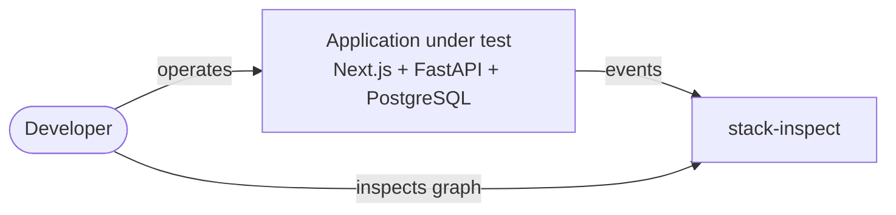
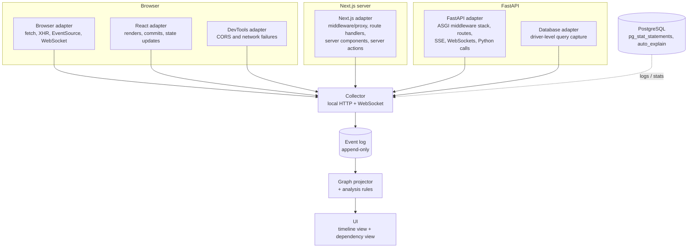

# Architecture

This document describes how stack-inspect is built. It follows a trimmed-down [arc42](https://arc42.org) structure with [C4](https://c4model.com) diagrams. The reasoning behind individual decisions lives in [`adr/`](adr/).

## 1. Context



The developer runs their app locally with stack-inspect enabled, uses the app, and watches the execution graph build up in the stack-inspect UI.

## 2. Components



| Component | Responsibility |
| :-- | :-- |
| Browser adapter | Wraps `fetch`, `XMLHttpRequest`, `EventSource` and `WebSocket`. Adds trace context to outgoing requests and records request, stream and message events. |
| React adapter | Hooks into React's DevTools global hook to record renders, commits, state updates and effects. |
| DevTools adapter | Reads browser network failures through the Chrome DevTools Protocol, including CORS failure reasons, which are hidden from page JavaScript. See §6. |
| Next.js adapter | Uses Next.js instrumentation (`instrumentation.ts`) plus Node HTTP instrumentation. Records middleware/proxy decisions, route handlers, server components and server actions. |
| FastAPI adapter | Wraps each layer of the ASGI middleware stack, routes, streaming responses and WebSocket endpoints. Optionally records the Python call tree. |
| Database adapter | Hooks the database driver (asyncpg, or SQLAlchemy events on any engine) to record each query and its normalised fingerprint. Parameter values, and a short preview of rows asyncpg already returned, are recorded only when `STACK_INSPECT_VALUES=1`. |
| Collector | Local process that receives events from every adapter and appends them to the event log. |
| Graph projector | Turns the event log into graphs and runs the analysis rules. |
| UI | Three linked views on one page: a timeline whose lanes are the browser, Next.js, the API and the database; a picture of the accumulated graph; and findings that open into an explanation of what was observed. The graph panel toggles between a force-directed drawing, a sequence diagram, and a latency chart of the same visible nodes. The sequence diagram has one column per layer, and each link is a message in the order it was first seen. The latency chart draws one line per finished request or query on the same clock as the timeline. Its vertical axis is a log scale fitted to the runs at the playhead, in decades, and it grows as the playhead moves forward. A line on the graph or the sequence diagram that ends on a finished request takes its colour from that request's median duration. Filters, the playhead and findings apply to all three, and only the drawing on screen is painted. The timeline is one arrangement of the whole recording. Long pauses between clicks are shortened so the clips sit together, and each story keeps its own order. Play starts from the beginning and the picture grows up to the playhead. A dot starts small and grows each time that thing runs again, up to the playhead. Dragging the ruler or the playhead sets the moment. The graph controls can narrow that picture further. |

The collector choice is recorded in [ADR 0002](adr/0002-local-collector.md).

## 3. Graph model

The full model is in [ADR 0003](adr/0003-event-schema-and-graph-model.md). In summary:

- **Events** are the raw record: something started, ended or happened at an instant. Adapters emit them, and they're never edited.
- **Nodes** are stable identities that persist across interactions, such as "the `ResultsPanel` component", "`GET /api/results`" or "SQL fingerprint `a1b2c3`". Many events belong to one node.
- **Edges** connect nodes and carry evidence: how many times they've been seen, when last seen, and whether they were observed, inferred or declared. An edge that leaves a click also records `followed`: how many distinct presses of that control were followed by this consequence. A second fetch inside one press raises `count` and leaves `followed` unchanged.

Node kinds:

```text
interaction · state-update · render · effect · middleware · request
· stream · stream-message · function-call · query · error
```

Edge kinds:

| Edge | Meaning | Needed for |
| :-- | :-- | :-- |
| `contained` | Ran inside another operation | Execution graph |
| `caused` | Directly triggered another event | Execution graph |
| `awaited` | Waited for another operation | Execution graph |
| `retried` | A failure led to another attempt | Execution graph |
| `duplicated` | Equivalent work happened more than once | Execution graph |
| `emitted` | A stream produced a message | Execution graph |
| `read` | Read a value | Invalidation graph |
| `invalidated` | A change marked something stale | Invalidation graph |

`read` and `invalidated` exist from day one even though the execution graph doesn't produce them. See §8.

When the collector is started with `--root`, it reads those directories as it starts, again when the recording is reset, and again when a source file changes. The reading stays beside the event log. A declared edge is drawn only when both of its ends have already been observed, as a dashed line. With no roots, nothing is read and the working directory is not guessed. The scan refuses a root that contains stack-inspect. It does not follow dynamic routes, SQL built by concatenation, or ordinary variable reads. See [ADR 0014](adr/0014-declared-edges-from-source.md).

## 4. Linking events across layers

Within a process, adapters use the runtime's own context mechanism: `AsyncLocalStorage` in Node and `contextvars` in Python. Across HTTP, they use the W3C `traceparent` header. See [ADR 0005](adr/0005-cross-layer-correlation.md).

The span id in that header is also a cause. The hop that sends it records `spanId` on its event, and the hop that receives it records `parentSpanId`. The projector draws a `caused` edge between those two nodes. See [ADR 0015](adr/0015-span-id-is-a-cause.md). A click's event id is the `parentId` of the browser request, stream or storage call that follows it, until the next click. A React render names the state update that changed in the same commit, or the nearest ancestor state update when its own state did not change. That is a cause, not a record of which value the component read. See [the React read spike](spikes/0001-react-reads.md). A query keeps its placeholders in the statement and does not record which request parameter was bound. Bound values, a short preview of returned rows, path parameters, query-string parameters and the React state value that changed are stored only when `STACK_INSPECT_VALUES=1`. The Values control, on by default, draws those values halfway along each line on the graph and on the sequence diagram. The caption is the run at the playhead. A dot with no line shows the same label beside it. A matching value does not become an edge. See [the backend read spike](spikes/0002-backend-reads.md) and [ADR 0016](adr/0016-optional-parameter-values.md).

```text
Browser ──traceparent──▶ Next.js ──traceparent──▶ FastAPI ──sqlcommenter──▶ PostgreSQL
```

For PostgreSQL, the trace ID is also appended to each query as a SQL comment ([sqlcommenter](https://google.github.io/sqlcommenter/) style). Database-side logs such as `auto_explain` output can then be matched to the request that issued the query.

HTTP headers don't cover everything:

- **Anything that is not HTTP** continues a trace only when the application copies it. `inject` writes the active `traceparent` into a plain string map, and `extract` reads it back. A queue property, a blob's metadata, or a job payload are all just maps. stack-inspect does not know which product they belong to.
- A process sets `STACK_INSPECT_SERVICE` to name itself. The UI uses that name when a trace contains more than one service. The name is not a fixed list of roles.
- **CORS preflights** are sent by the browser itself and don't carry our headers. See §6.
- **`EventSource` and `WebSocket`** in the browser can't set custom headers. See §7.

All processes run on one machine, so wall-clock timestamps are good enough for ordering across processes. Within a process, ordering uses a monotonic clock.

## 5. Python call tree

The FastAPI adapter can optionally record Python function calls between the route and the database. Options, from lightest to heaviest:

1. **Sampling** (`py-spy`-style): low overhead, but misses short calls.
2. **`sys.monitoring`** (PEP 669, Python 3.12+): low-overhead event hooks. The preferred option.
3. **`sys.setprofile` / `sys.settrace`**: complete but slow. The fallback for older Pythons.

Calls are filtered to application code by default, excluding the standard library and installed packages. Async tasks inherit context through `contextvars`, so calls stay attached to the request that spawned them.

## 6. Middleware and CORS observation

CORS failures are a frequent pain point, and they're hard to debug because **the browser deliberately hides the failure reason from page JavaScript**. `fetch` just rejects with a generic `TypeError`. Observation therefore comes from two sides. See [ADR 0008](adr/0008-middleware-and-cors-observation.md).

**Server side (FastAPI and Next.js):**

- Every layer of the ASGI middleware stack is wrapped, so each request records which middleware ran, in what order, and which one produced the response.
- Preflight (`OPTIONS`) requests are recorded as `middleware` nodes with the request's `Origin`, `Access-Control-Request-Method` and `Access-Control-Request-Headers`, and the CORS headers sent back.
- Every response records whether CORS headers were present.
- Next.js middleware (`middleware.ts`, renamed `proxy.ts` in Next.js 16) records rewrites, redirects and early responses.

**Browser side:**

- The DevTools adapter listens for `Network.loadingFailed` events, whose `corsErrorStatus` field gives the specific reason, and for CORS issues reported through the `Audits` domain.
- The failure is matched to the server-side record by URL and timing, since preflights carry no trace context.

**Known failure pattern:** in Starlette/FastAPI, an unhandled exception is turned into a 500 by `ServerErrorMiddleware`, which sits *outside* `CORSMiddleware`. The 500 response therefore has no CORS headers, and the browser reports a CORS error instead of a server error. Recording the middleware order and the headers on each response makes this visible, and it gets its own analysis rule (§9).

**Topology matters:** calls routed through Next.js to FastAPI server-side are same-origin from the browser's point of view and never trigger CORS. Calls from the browser straight to FastAPI do. The graph records which route each call took.

## 7. Long-lived connections: SSE and WebSockets

Streams don't fit the "one request, one timing bar" model. A connection can stay open for minutes and carry many messages. See [ADR 0007](adr/0007-stream-model.md).

- A connection is a `stream` node with lifecycle events: opened, reconnected, closed or errored.
- Each message is a `stream-message` event linked to its stream by connection ID and sequence number.
- `emitted` edges link the backend operation that produced a message to the message. `caused` edges link a message to the frontend state update it triggered.

**Getting trace context onto streams:** the browser's `EventSource` and `WebSocket` APIs can't set custom headers. In development, the browser adapter adds the trace context as a query parameter on the connection URL. For WebSockets, each message is additionally wrapped in a small development-only envelope carrying the trace context, which the FastAPI adapter unwraps before the application sees it.

**SSE reconnects:** reconnections using `Last-Event-ID` are recorded as the same logical stream, so dropped connections and replays are visible.

## 8. Designing for the invalidation graph

The long-term goal is the full invalidation graph (see the [vision](vision.md)). The following commitments keep it reachable without building it now. See [ADR 0004](adr/0004-invalidation-ready-graph-model.md).

1. **The event log is the source of truth.** Graphs are derived from it, so new inference can be run over old recordings.
2. **Nodes have stable identities**, so "this component read this value" can be tracked across interactions.
3. **Every event has an optional `causeIds` field**, even when nothing fills it in yet.
4. **`read` and `invalidated` edge kinds exist in the schema** from day one.
5. **Every edge records how it was learned** (`observed`, `inferred` or `declared`), so edges supplied by libraries or inferred later can coexist with observed ones.

Likely sources of `read` and `invalidated` edges, roughly in order of feasibility:

- Libraries that already track subscriptions, such as TanStack Query and SWR (cache keys, observers, invalidations).
- React state setters, context providers and changed props.
- FastAPI request parameters flowing into queries.
- PostgreSQL writes matched to cached reads of the same tables.

## 9. Analysis rules

Rules run over the projected graph and raise findings in the UI:

- The same query fingerprint executed repeatedly within one interaction (N+1 queries).
- Sequential awaits with no observed dependency between them.
- A state update causing an unusually large render subtree.
- A component re-rendering with no changed props or relevant state.
- An effect repeatedly cancelled and restarted.
- Duplicate requests with equivalent URLs or cache keys.
- A 5xx response missing CORS headers (reported to the browser as a CORS error).
- A preflight rejected, or a response missing an expected CORS header.
- A stream reconnecting repeatedly, or messages arriving with no observed consumer.
- Work finishing after the user-visible result was already rendered.

Each finding names the `nodeKey`s it is about. Opening one in the UI paints those nodes red and emphasises any `duplicated` edges that join them. Extra runs of the same request or query stay one node; the projector records a counted `duplicated` edge from a parent when one exists, so the count carries the multiplicity. A link that would start and end on the same node is not drawn.

## 10. Development-only guarantee

Summarised from [ADR 0006](adr/0006-development-only-guarantee.md): adapters are opt-in, refuse to start unless an explicit development flag is set, refuse to start in production builds, and bind the collector to `localhost` only.

## 11. Packaging and dependencies

Work repositories install the adapters as development dependencies, and audit their full dependency tree at strict thresholds. So stack-inspect is split by where it gets installed ([ADR 0011](adr/0011-minimal-runtime-dependencies.md)):

- **Adapters** go into the app's lockfile. They depend on the standard library, plus the app's own frameworks as peer or optional dependencies.
- **Collector, graph projector and UI** run as a standalone tool (`uvx`/`npx` or a container) and never enter the app's lockfile.

Optional integrations, such as OpenTelemetry instrumentation or TanStack Query, are optional extras.

## 12. Quality and security

- [Testing](testing.md): unit, integration, and Gherkin acceptance tests with playwright-bdd ([ADR 0009](adr/0009-testing-strategy.md)).
- [Security posture](security-posture.md): CI gates matching the JusticeAIUnit estate at identical thresholds ([ADR 0010](adr/0010-security-gates-aligned-with-work.md)).
- [Code quality](code-quality.md): pre-commit linters and the inline-only suppression policy ([ADR 0012](adr/0012-pre-commit-and-suppression-policy.md)).
